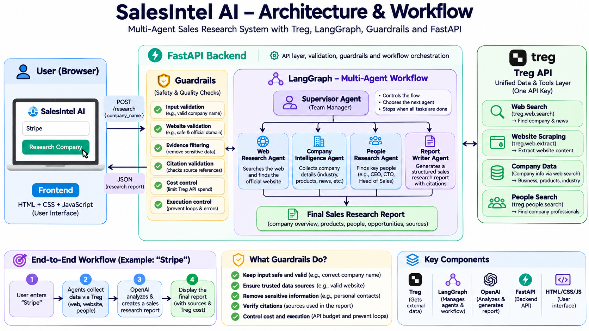
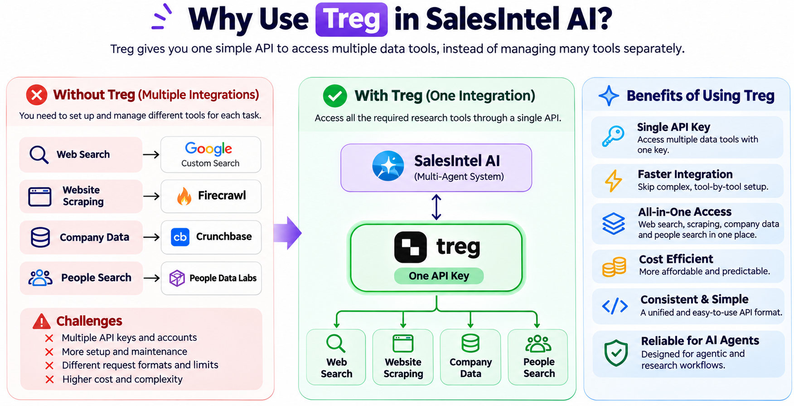

# SalesIntel AI --- Project Overview


## 1. What is this project?

SalesIntel AI is an AI-powered Sales Research Multi-Agent System that automatically researches companies and generates detailed sales intelligence reports.

**Example:** A salesperson wants to approach Stripe. Instead of manually searching the internet, they enter `Stripe` into the application. The system collects company information, products, key people and potential sales opportunities.



## 2. How does it work?

``` text
User enters a company name (Stripe)
                |
                v
          FastAPI Backend
                |
                v
        LangGraph Supervisor
                |
                v
       Web Research Agent ------> Treg
                |
                v
       Company Intelligence ----> Treg
                |
                v
       People Research Agent ---> Treg
                |
                v
       Report Writer Agent -----> LLM
                |
                v
       Validation & Final Report
                |
                v
          User Interface
```

The supervisor coordinates the agents one by one. Each agent returns its findings to the shared state before the supervisor selects the next task.

## 3. Agents and Their Responsibilities

Our system consists of four specialized agents and one supervisor.

| Agent | Responsibility | Example (Stripe) |
| --- | --- | --- |
| **Supervisor** | Controls the workflow and decides which agent runs next. | Starts web research, followed by company and people research. |
| **Web Research Agent** | Searches the internet, identifies the official website and extracts content. | Finds stripe.com and relevant news. |
| **Company Intelligence Agent** | Collects company, business and product information. | Learns about Stripe's payment services. |
| **People Research Agent** | Finds relevant professionals using the company domain. | Finds Stripe executives and decision-makers. |
| **Report Writer Agent** | Uses an LLM to generate a structured report with citations. | Creates a complete sales research brief. |


# 4. What is Treg, and why are we using it?

An AI model can understand information and generate text. However, it needs external tools to collect up-to-date information from the internet.

This is where Treg comes in.

Treg acts as a unified gateway between our AI agents and external data providers.

Without Treg, we might need separate accounts, API keys and integrations for web search, website scraping and people research.

With Treg, we can access these services through one API key.


